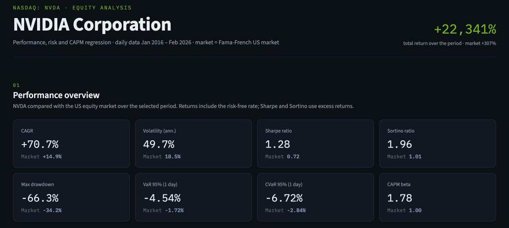
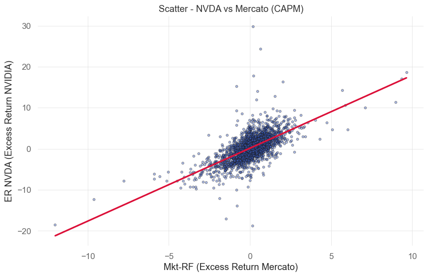

# 📈 Return Analysis

A collection of quantitative equity analyses built in Python — one stock at a time.  
Each analysis combines a Jupyter notebook for research and a Streamlit dashboard for interactive visualization.

---

## What this repo is about

This project applies standard quantitative finance tools to individual equities, starting with **NVIDIA (NVDA)**.  
The goal is to build a repeatable, modular framework that can be extended to any publicly traded stock.

For each company, the workflow is:

1. **Jupyter Notebook** — downloads price data via `yfinance` and Fama-French factors, computes excess returns, runs descriptive statistics, fits a CAPM regression via OLS, and exports results to Excel.
2. **Excel file** — the output of the notebook, used as the data source for the dashboard (no live internet connection required at runtime).
3. **Streamlit Dashboard** — loads the pre-computed Excel, renders interactive charts and performance metrics using Plotly.

---

## Current analyses

| Company | Ticker | Period | Notebook | Dashboard |
|---|---|---|---|---|
| NVIDIA Corporation | NVDA | Jan 2016 – Feb 2026 | `NVIDIA/NVIDIA.ipynb` | [🚀 Launch Dashboard](https://return-analysis-nvidia-1.streamlit.app) |


*Dashboard overview: NVDA vs the US market over the full period.*

### What the dashboard shows

- **Performance overview**: CAGR, volatility, Sharpe, Sortino, max drawdown, VaR and CVaR, each compared with the market
- **Growth of $1 and drawdowns**: NVDA vs the market, linear or log scale
- **Calendar-year returns**
- **Rolling risk**: annualised volatility and CAPM beta on a 3-month, 6-month or 1-year window
- **Return distribution**: histogram vs normal, Q-Q plot, moments and Jarque-Bera test
- **CAPM regression**: scatter with the characteristic line, OLS table, annualised alpha and a plain-language reading of the results

Every number updates with the selected period (1Y, 3Y, 5Y, Max).


*From the notebook: daily NVDA excess returns vs market excess returns, with the fitted CAPM line.*

---

## Methodology

### Data
- **Prices**: adjusted close prices from Yahoo Finance via `yfinance`
- **Risk-free rate & market factor**: daily Fama-French factors (`Mkt-RF`, `RF`) from Kenneth French's data library

### Metrics computed
- **Distributional moments**: mean, standard deviation, skewness, excess kurtosis
- **Performance**: CAGR, annualized volatility, Sharpe ratio, Sortino ratio
- **Risk**: maximum drawdown, historical VaR and CVaR at 95% (daily)
- **CAPM regression** (OLS): alpha (daily and annualised), beta, R², t-statistics, p-values, Durbin-Watson
- **Rolling volatility and beta**: moving-window estimates to capture time-varying risk

The notebook uses [`quantstats`](https://github.com/ranaroussi/quantstats). The dashboard computes the same metrics directly with NumPy so that it can recompute them for any period; VaR and CVaR are historical, and CAGR and drawdowns use total returns (excess return + risk-free rate).

---

## Repository structure

```
Return_Analysis/
└── NVIDIA/
    ├── NVIDIA.ipynb          # Research notebook
    ├── nvda_analysis.xlsx    # Output of the notebook (data source for dashboard)
    ├── requirements.txt      # Notebook dependencies
    └── dashboard/
        ├── nvda_dashboard.py # Streamlit app
        ├── nvda_analysis.xlsx
        └── requirements.txt
```

---

## How to run

### 1 — Notebook
Open `NVIDIA/NVIDIA.ipynb` in Jupyter and run all cells.  
This will generate `nvda_analysis.xlsx` with four sheets: `NVDA_Prices`, `FamaFrench_3F`, `ER_Analysis`, `OLS_Results`.

### 2 — Dashboard (local)
```bash
pip install -r NVIDIA/dashboard/requirements.txt
streamlit run NVIDIA/dashboard/nvda_dashboard.py
```

### 2 — Dashboard (Streamlit Cloud)
The app is deployed on Streamlit Cloud. Dependencies are declared in `requirements.txt` and picked up automatically.  
The dashboard reads `nvda_analysis.xlsx` from its own folder — no live data download at runtime.

---

## Stack

`Python` · `pandas` · `numpy` · `yfinance` · `statsmodels` · `quantstats` (notebook) · `scipy` · `plotly` · `streamlit` · `openpyxl`

---

## Roadmap

- [ ] Apple (AAPL)
- [ ] Microsoft (MSFT)
- [ ] Tesla (TSLA)
- [ ] Multi-stock comparison notebook
- [ ] Fama-French 3-factor and 5-factor extensions

---

## Author

Feel free to open an issue or a pull request if you want to contribute an analysis for another stock.
